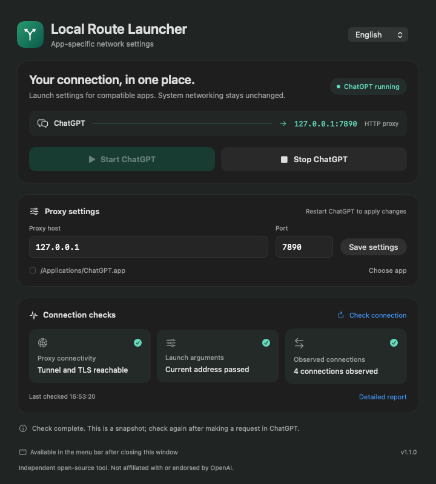
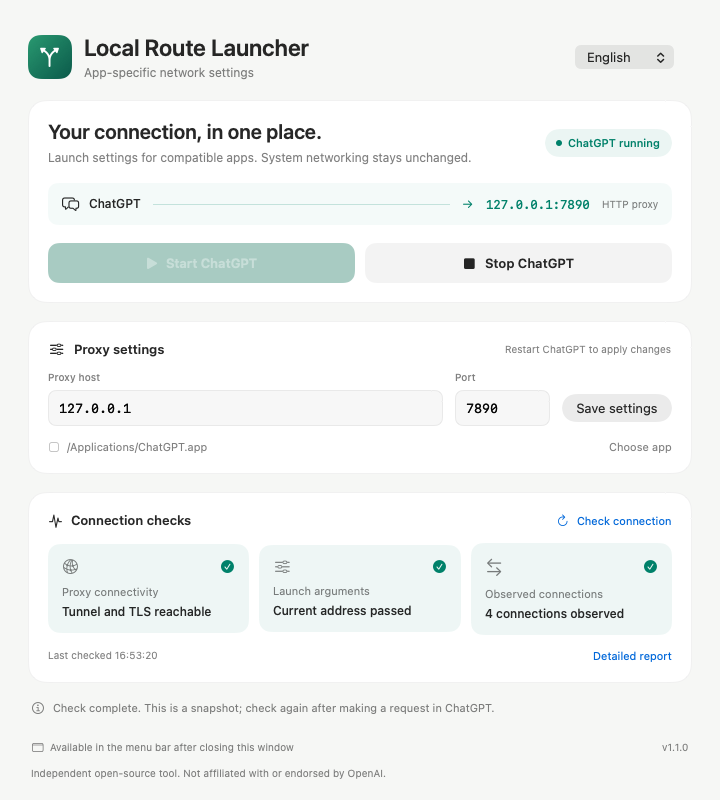

<h1 align="center">Local Route Launcher</h1>
<p align="center">A native macOS utility for app-specific launch settings</p>

<p align="center">
  <a href="https://github.com/oliver804/ChatGPT-Proxy-Launcher/releases/tag/v1.1.0"></a>
  
  
  <a href="LICENSE"></a>
</p>
<p align="center">
  <a href="README.md">简体中文</a> · <b>English</b><br>
  <a href="https://oliver804.github.io/ChatGPT-Proxy-Launcher/en/">Website</a> ·
  <a href="https://github.com/oliver804/ChatGPT-Proxy-Launcher/releases/tag/v1.1.0">Download</a> ·
  <a href="#quick-start">Quick start</a> ·
  <a href="#faq">FAQ</a> ·
  <a href="https://github.com/oliver804/ChatGPT-Proxy-Launcher/issues">Report an issue</a>
</p>

## Preview

<table>
  <tr>
    <th width="50%">Dark</th>
    <th width="50%">Light</th>
  </tr>
  <tr>
    <td><a href="docs/images/preview-dark.en.png"></a></td>
    <td><a href="docs/images/preview-light.en.png"></a></td>
  </tr>
</table>

<sub>v1.1.0 interface rendered with sample diagnostic data. Chinese and English are available in the app.</sub>

## About

Local Route Launcher saves local HTTP proxy settings and passes them to compatible Electron-based ChatGPT installations at launch. It uses a proxy you already run and does not supply network access or a proxy service.

It uses application-supported launch arguments and environment variables, without changing system proxy or DNS settings. Built with SwiftUI + AppKit, with no third-party runtime dependencies.

## Features

- **Dedicated proxy**: save a host and port; supports HTTP proxies and compatible mixed proxy ports without authentication.
- **Start and stop**: launch ChatGPT with proxy settings or request a graceful shutdown.
- **Connection checks**: inspect proxy connectivity, actual launch arguments, and application TCP connections.
- **Menu bar controls**: start, stop, and check status; closing the main window hides the Dock icon.
- **Native interface**: light and dark appearance; instant Chinese / English switching, with the choice saved for future launches.

## Download and install

| Version | Requirements | Download |
| --- | --- | --- |
| **v1.1.0** | Apple Silicon · macOS 13+ | [Download DMG](https://github.com/oliver804/ChatGPT-Proxy-Launcher/releases/download/v1.1.0/Local-Route-Launcher-1.1.0-arm64.dmg) |

Open the DMG and drag **Local Route Launcher** to **Applications**. The [release page](https://github.com/oliver804/ChatGPT-Proxy-Launcher/releases/tag/v1.1.0) also provides a source archive and SHA-256 checksums.

> Only detectable **Electron versions of ChatGPT** are supported. Older native versions and Intel Macs are unsupported by the current release.

## Quick start

1. Keep an authorized local HTTP proxy running. Choose **English** or **简体中文** from the launcher’s language picker.
2. Enter the host and port, such as `127.0.0.1` and `7890`, then click **Save settings**.
3. Fully quit any running ChatGPT instance, then click **Start ChatGPT**.
4. Click **Check connection** and open the detailed report if needed.

**Restart ChatGPT after changing settings, and use the launcher for future launches.** Opening ChatGPT directly from the Dock does not automatically apply the proxy settings saved here.

Controls remain accessible from the menu bar after closing the main window. Quitting the launcher does not stop a running ChatGPT instance.

## FAQ

<details>
<summary><b>What if macOS blocks the app on first launch?</b></summary>

Current builds use an ad-hoc signature and are not Developer ID signed or notarized by Apple. After verifying that the download came from this project's release page, allow it in **System Settings → Privacy & Security**. There is no need to disable SIP or system security checks.

</details>

<details>
<summary><b>Does the launcher provide a proxy? Does all traffic use it?</b></summary>

The launcher requires an existing local HTTP proxy. It passes settings to compatible applications without changing system proxy or DNS configuration. It does not guarantee routing for every component.

The proxy primarily covers Chromium HTTP, HTTPS, and WebSocket requests, with QUIC disabled. Voice, WebRTC, UDP, and child processes that ignore proxy environment variables are not guaranteed to use it. Behavior may also change with ChatGPT or Electron updates.

</details>

<details>
<summary><b>How should I interpret connection checks?</b></summary>

| Check | Meaning |
| --- | --- |
| Proxy connectivity | A CONNECT tunnel was established and a TLS website response received through the configured proxy |
| Launch arguments | The ChatGPT main process carries proxy arguments matching the current settings |
| Observed connections | A snapshot shows TCP connections from the app or its children to the proxy |

HTTP 403 indicates a response during the tunnel and TLS check, not working chat or account access. A snapshot cannot prove all traffic uses the proxy, and the absence of a connection does not prove direct access. Proxy hostnames may not match numeric IP addresses in socket snapshots.

</details>

<details>
<summary><b>How do I update the app?</b></summary>

Quit the old launcher from its menu bar panel, then install **Local Route Launcher.app**. If upgrading from v1.0.0, remove the old launcher app after verifying the new one; do not run both copies. The preferences identifier is retained, so saved settings carry over. ChatGPT can keep running. Language changes take effect immediately; macOS-owned menus and dialogs may follow the system language.

</details>

## Development

Requires an Apple Silicon Mac, Xcode Command Line Tools (Swift 5.9+), and Python 3.

```sh
make check       # Privacy and script checks
make test        # Core tests
make build       # Build the app
make dmg         # Create DMG, source ZIP, and checksums
make verify      # Validate the package, signature, and icon
```

The app is written to `build/release/`, and release files to `dist/1.1.0/`. [`VERSION`](VERSION) is the single build-version source.

`make integration` and `make ui` require a logged-in macOS graphical session and only operate dedicated test apps and windows. `make previews` renders previews using sample data.

[Issues](https://github.com/oliver804/ChatGPT-Proxy-Launcher/issues) and PRs are welcome. See [Contributing](CONTRIBUTING.md), [Architecture](docs/ARCHITECTURE.en.md), and [Releasing](docs/RELEASING.en.md) for development details.

## Privacy and license

No login, telemetry, or automatic uploads; settings stay on your Mac. Connection checks send a HEAD request to `chatgpt.com` through the configured proxy without account credentials. Reports are displayed locally; remove private paths, internal addresses, and other sensitive details before sharing. [Privacy](docs/PRIVACY.en.md) · [Security](SECURITY.md)

**Author: Oliver** · [oliver804x@gmail.com](mailto:oliver804x@gmail.com)<br>
**License: [MIT](LICENSE)** · [Changelog](CHANGELOG.md)

Independent project, not affiliated with, sponsored by, or endorsed by OpenAI. ChatGPT is a trademark of OpenAI and is mentioned only to identify compatibility. Use only with networks and services you are authorized to access; applicable laws and service terms still apply. [Usage boundaries](docs/USAGE.en.md) · [Third-party notices](THIRD_PARTY_NOTICES.md) · [Project introduction](docs/ANNOUNCEMENT.en.md).

The existing repository URL is retained for link continuity; the public app name is **Local Route Launcher**.
