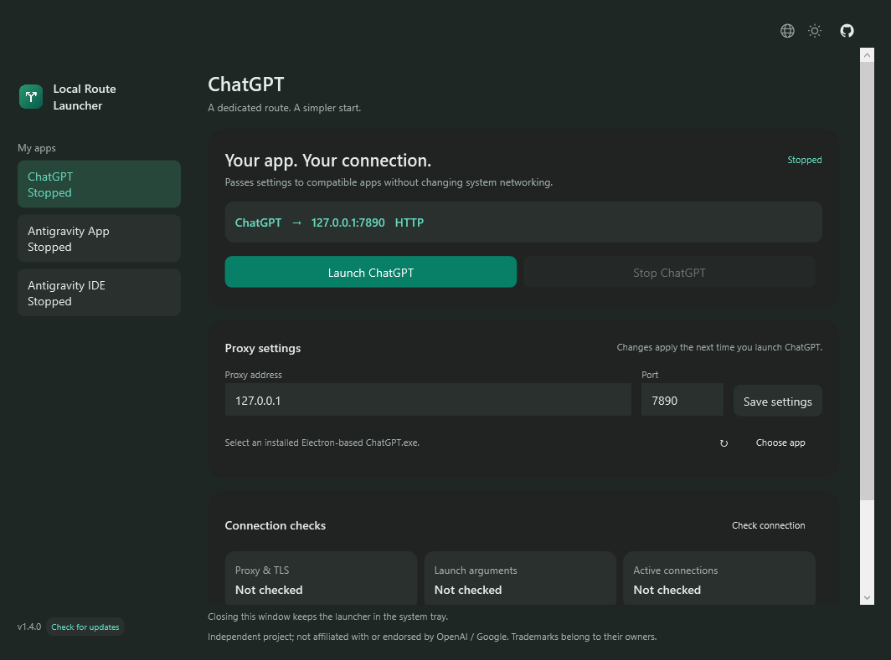
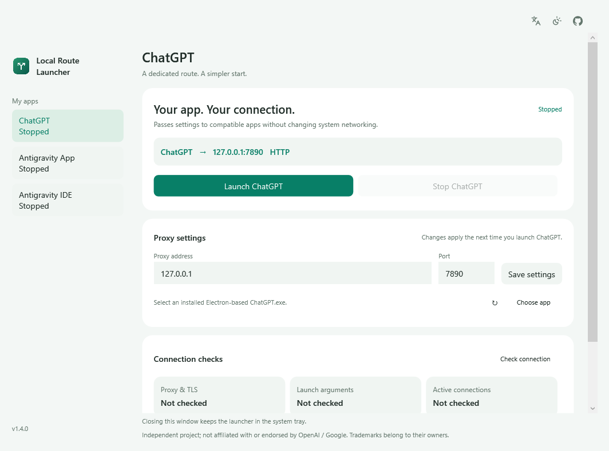

<h1 align="center">Local Route Launcher</h1>
<p align="center">App-specific launch settings for macOS and Windows</p>

<p align="center">
  <a href="https://github.com/oliver804/Local-Route-Launcher/releases/tag/v1.4.0"></a>
  
  
  
  <a href="LICENSE"></a>
</p>
<p align="center">
  <a href="README.md">简体中文</a> · <b>English</b><br>
  <a href="https://oliver804.github.io/Local-Route-Launcher/en/">Website</a> ·
  <a href="https://github.com/oliver804/Local-Route-Launcher/releases/tag/v1.4.0">Download</a> ·
  <a href="#quick-start">Quick start</a> ·
  <a href="#faq">FAQ</a> ·
  <a href="https://github.com/oliver804/Local-Route-Launcher/issues">Report an issue</a>
</p>

> v1.4.0 is under development and testing, not yet publicly released. The current stable release is [v1.3.0](https://github.com/oliver804/Local-Route-Launcher/releases/tag/v1.3.0).

## Preview

<table>
  <tr>
    <th width="50%">Dark</th>
    <th width="50%">Light</th>
  </tr>
  <tr>
    <td><a href="docs/images/preview-dark.en.png"></a></td>
    <td><a href="docs/images/preview-light.en.png"></a></td>
  </tr>
</table>

<sub>macOS v1.4.0 interface rendered with sample diagnostic data. Nine interface languages are available in the app.</sub>


<details>
<summary><b>Windows preview</b></summary>

<table>
  <tr><th width="50%">Dark</th><th width="50%">Light</th></tr>
  <tr><td></td><td></td></tr>
</table>

<sub>Windows WPF interface preview rendered with default settings; no account data.</sub>
</details>

## About

Local Route Launcher saves local HTTP proxy settings and passes them to compatible Electron-based ChatGPT, Antigravity App and Antigravity IDE installations at launch. It uses a proxy you already run and does not supply network access or a proxy service.

It uses application-supported launch arguments and environment variables, without changing system proxy or DNS settings. Built with SwiftUI + AppKit on macOS and WPF on Windows. The Windows installer includes its .NET runtime.

## Features

- **Dedicated proxy**: save a host and port; supports HTTP proxies and compatible mixed proxy ports without authentication.
- **Multi-app profiles**: independent configuration and launch controls for ChatGPT, Antigravity App and Antigravity IDE.
- **Start and stop**: launch the selected app with proxy settings or request a graceful shutdown.
- **Connection checks**: inspect proxy connectivity, actual launch arguments, and application TCP connections.
- **Menu bar / system tray**: start, stop, and check status; closing the window hides its Dock or taskbar entry.
- **Native interface**: light and dark appearance; instant switching among nine interface languages, with the choice saved for future launches.

Interface languages: English, Simplified Chinese, Traditional Chinese, Russian, Persian, Belarusian, Spanish, Arabic, and Portuguese.

## Download and install

| Version | Requirements | Download |
| --- | --- | --- |
| **v1.4.0** | Apple Silicon · macOS 13+ | [Download DMG](https://github.com/oliver804/Local-Route-Launcher/releases/download/v1.4.0/Local-Route-Launcher-1.4.0-arm64.dmg) |
| **v1.4.0** | Windows 10 22H2 / Windows 11 · x64 | [Download EXE installer](https://github.com/oliver804/Local-Route-Launcher/releases/download/v1.4.0/Local-Route-Launcher-1.4.0-windows-x64-setup.exe) |

Open the DMG and drag **Local Route Launcher** to **Applications**. The [release page](https://github.com/oliver804/Local-Route-Launcher/releases/tag/v1.4.0) also provides a source archive and SHA-256 checksums.

> Detectable **Electron versions of ChatGPT, Antigravity App and Antigravity IDE** are supported. Older native versions, Intel Macs and Windows ARM64 are unsupported by the current release. Restricted Microsoft Store packages may not allow direct launch.

**Windows:** run the EXE installer for the current user; no separate .NET installation is needed. Includes nine interface languages, system tray controls and light / dark themes. The launcher searches installed packages; use **Choose app** to select a compatible executable for the selected app if needed. Windows ARM64 is not a supported or validated target.

The installer is not Authenticode-signed and may trigger SmartScreen. Verify the release origin and SHA-256; do not disable security protections. Follow your administrator’s policy on managed devices.

## Quick start

1. Keep an authorized local HTTP proxy running. Choose your language from the launcher’s language picker.
2. Enter the host and port, such as `127.0.0.1` and `7890`, then click **Save settings**.
3. Select the app in the sidebar, save any open work and quit it normally, then click its **Start** button.
4. Click **Check connection** and open the detailed report if needed.

**Restart the selected app after changing settings, and use the launcher for future launches.** Opening the app directly from the Dock does not automatically apply the proxy settings saved here.

Controls remain accessible from the macOS menu bar or Windows system tray after closing the main window. Quitting the launcher does not stop a running ChatGPT instance.

## FAQ

<details>
<summary><b>What if macOS blocks the app on first launch?</b></summary>

Current builds use an ad-hoc signature and are not Developer ID signed or notarized by Apple. After verifying that the download came from this project's release page, allow it in **System Settings → Privacy & Security**. There is no need to disable SIP or system security checks.

</details>

<details>
<summary><b>Does the launcher provide a proxy? Does all traffic use it?</b></summary>

The launcher requires an existing local HTTP proxy. It passes settings to compatible applications without changing system proxy or DNS configuration. It does not guarantee routing for every component.

The proxy primarily covers Chromium HTTP, HTTPS, and WebSocket requests, with QUIC disabled. Voice, WebRTC, UDP, and child processes that ignore proxy environment variables are not guaranteed to use it. Behavior may also change with ChatGPT or Electron updates.

</details>

<details>
<summary><b>How should I interpret connection checks?</b></summary>

| Check | Meaning |
| --- | --- |
| Proxy connectivity | A CONNECT tunnel was established and a TLS website response received through the configured proxy |
| Launch arguments | The selected app’s main process carries proxy arguments matching the current settings |
| Observed connections | A snapshot shows TCP connections from the app or its children to the proxy |

HTTP 403 indicates a response during the tunnel and TLS check, not working chat or account access. A snapshot cannot prove all traffic uses the proxy, and the absence of a connection does not prove direct access. Proxy hostnames may not match numeric IP addresses in socket snapshots.

</details>

<details>
<summary><b>How do I update the app?</b></summary>

**Windows:** quit the launcher from its tray, then run the new installer. Saved settings are preserved.

**macOS:** quit the old launcher from its menu bar panel, then install **Local Route Launcher.app**. If upgrading from v1.0.0, remove the old launcher app after verifying the new one; do not run both copies. The preferences identifier is retained, so saved settings carry over. ChatGPT can keep running. Language changes take effect immediately; macOS-owned menus and dialogs may follow the system language.

</details>

## Development

**macOS development:** requires an Apple Silicon Mac, Xcode Command Line Tools (Swift 5.9+), and Python 3.

```sh
make check       # Privacy and script checks
make test        # Core tests
make build       # Build the app
make dmg         # Create DMG, source ZIP, and checksums
make verify      # Validate the package, signature, and icon
```

The app is written to `build/release/`, and release files to `dist/1.4.0/`. [`VERSION`](VERSION) is the single build-version source.

`make integration` and `make ui` require a logged-in macOS graphical session and only operate dedicated test apps and windows. `make previews` renders previews using sample data.

**Windows development:** use Windows x64, .NET SDK 10.0.402 and Inno Setup 6.

```powershell
./scripts/build-windows.ps1 -Test
```

The installer is written to `dist/1.4.0/`. Tests use an isolated fixture, not a real ChatGPT account.

[Issues](https://github.com/oliver804/Local-Route-Launcher/issues) and PRs are welcome. See [Contributing](CONTRIBUTING.md), [Architecture](docs/ARCHITECTURE.en.md), and [Releasing](docs/RELEASING.en.md) for development details.

## Privacy and license

No login, telemetry, or automatic uploads; settings stay on your device. Connection checks send a HEAD request to `chatgpt.com` through the configured proxy without account credentials. Reports are displayed locally; remove private paths, internal addresses, and other sensitive details before sharing. [Privacy](docs/PRIVACY.en.md) · [Security](SECURITY.md)

**Author: Oliver** · [oliver804x@gmail.com](mailto:oliver804x@gmail.com)<br>
**License: [MIT](LICENSE)** · [Changelog](CHANGELOG.md)

Independent project, not affiliated with, sponsored by, or endorsed by OpenAI or Google. Product names and trademarks belong to their respective owners and identify compatibility only. Use only with networks and services you are authorized to access; applicable laws and service terms still apply. [Usage boundaries](docs/USAGE.en.md) · [Third-party notices](THIRD_PARTY_NOTICES.md) · [Project introduction](docs/ANNOUNCEMENT.en.md).

The existing repository URL is retained for link continuity; the public app name is **Local Route Launcher**.

### Multi-app support in v1.4.0

Select ChatGPT, Antigravity App, or Antigravity IDE in the sidebar. Each app has separate saved proxy settings, a retained editing draft, launch controls, and diagnostics. Existing ChatGPT settings are preserved. Choose any of the nine languages or Follow system from the main window or menu bar / tray; language is shared across all apps. Save work before stopping an app. New proxy settings take effect on its next launch.

Antigravity probes use `https://antigravity.google/`; ChatGPT probes use `https://chatgpt.com/`. Neither carries account credentials. Reports distinguish recognized `language_server` descendants from the rest of the process family. No observed connection is not proof of direct access; detached or remote services may be outside the snapshot.

Local macOS checks covered App 2.28.1 and IDE 2.6.0 identification, launch arguments, and observed proxy TCP connections. No authenticated AI prompt was sent. Windows fixtures verify launch mechanics, not real Antigravity account or model access. This independent project is not affiliated with or endorsed by OpenAI or Google; product names identify compatibility only.

The compact main/menu/tray layout shares language, appearance and GitHub controls at the upper right. The version-adjacent badge appears only when a newer stable launcher release has an installer for this platform. Clicking downloads that installer directly in your browser, without an intermediate panel. Run the downloaded installer to finish updating. No badge is shown otherwise; offline checks do not interrupt use. See the [UI baseline](docs/UI-DESIGN-1.4.md).
